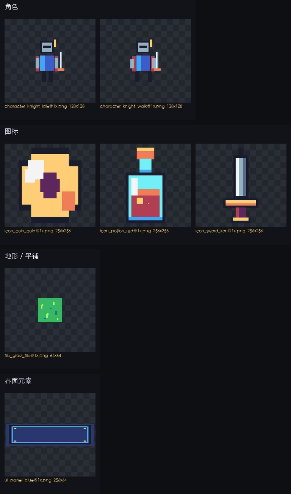

<div align="center">

# 游戏素材生成器

**一句话告诉 AI 你要什么游戏素材，它会自己问需求、定风格、画图、切图、校验，最后交给你一套能直接进引擎的素材包。**

[](LICENSE)




</div>

上面这套素材全部由仓库里的示例项目生成：角色两帧、三个背包图标、一块可平铺草地、一块九宫格面板。**没有调用任何外部生图 API，也没有配置任何图像 Key**——像素风、扁平风、UI、图标、tile 这类素材用代码绘制反而更精确、更可复现。

## 这是什么

做一套游戏素材，通常要经历「定风格 → 画角色 → 画图标 → 切精灵表 → 抠透明底 → 对齐尺寸 → 导进引擎」一长串工序。外包贵，自己画慢，AI 生图又常常尺寸不对、风格不统一、透明底带白边。

这个项目把整套流程写成了一份 AI 能读懂、能照着执行的工作规范（`AGENTS.md`），再配上一套确定性的 Python 工具链。你可以把仓库克隆到本地，用 Cursor、Claude Code、Codex 这类 AI 编程工具打开；也可以把它安装成 Skill，在任意游戏工程里随时调用。

你只需要说清楚：**做什么游戏、要哪些素材、什么风格、多大尺寸**。剩下的问询、风格锚点、批量生成、切图、校验、打包都由 AI 按规范完成。

## 能做什么

| 能力 | 说明 |
|---|---|
| 角色 / 怪物 | 立绘、动作帧、同一角色的多帧一致性、脚底基线对齐 |
| 动作帧与精灵表 | 自动拼图集，输出每帧坐标的 `atlas.json` |
| 道具 / 技能图标 | 透明底、统一描边与光源、批量多倍图（1x/2x/4x） |
| 场景背景 | 按分辨率 cover 填充，不透明输出 |
| 可平铺地形 | tile 接缝检测，支持 3×3 平铺验收 |
| UI 元素 | 九宫格边距校验、九宫格元数据 |
| 特效序列帧 | 多帧图集、锚点稳定检查 |
| 风格自定义 | 一个 `style.json` 控制色板、描边、光照、材质、负向词 |
| 尺寸自定义 | 预设 + 任意覆盖，支持单帧尺寸、多倍图、cell、留白、九宫格 |

## 快速开始

### 环境要求

- Python 3.9+
- [ImageMagick](https://imagemagick.org/)（渲染 SVG 代码绘制素材）
- Playwright + chromium（可选，渲染 HTML/Canvas 代码绘制素材）
- Node.js 不是必需的；只有用 `npx` 安装 Skill 时才需要

```bash
git clone <本仓库地址> ai-game-asset-maker
cd ai-game-asset-maker
pip install -r template/requirements.txt
python3 template/scripts/doctor.py
```

`doctor.py` 只检查不安装，会逐项告诉你缺了什么、该用什么命令补上。

### 克隆用法

用 AI 编程工具打开仓库目录，直接说：

> 帮我给一个像素风地牢游戏做一套素材：一个骑士（待机 + 行走）、5 个背包图标、一块草地 tile，尺寸 64 起步。

AI 会先问需求、给风格样图，确认后把工程建在 `outputs/<中文项目名>/`。

### Skill 用法

把这个目录安装成 Agent Skill（用你惯用的 skills 工具，或复制到 `~/.claude/skills/game-asset-maker/`），之后在任意游戏工程里说：

> 给这个项目做一套图标素材，风格跟现有 UI 一致。

AI 会读取当前工作区的游戏工程、现有素材和命名习惯，把产出放在当前目录的 `游戏素材/`，并提醒你把它加入 `.gitignore`。

### 跑一遍示例

```bash
# 1. 复制模板
mkdir -p /tmp/demo && cp -R template /tmp/demo/工程
cd /tmp/demo/工程

# 2. 覆盖示例配置与绘制代码
cp <仓库>/examples/像素冒险示例/{project.json,style.json,assets.yaml} .
cp <仓库>/examples/像素冒险示例/codegen/src/*.svg codegen/src/

# 3. 一条龙
python3 scripts/plan.py
python3 scripts/render.py --force
python3 scripts/process.py
python3 scripts/check_assets.py
python3 scripts/sheet.py
python3 scripts/export.py --dest /tmp/demo/交付
```

打开 `/tmp/demo/交付/预览/联系表.jpg` 就能看到成品。

## 三份可编辑配置

### `style.json`：风格

```json
{
  "name": "赛博像素",
  "keywords": ["16-bit pixel art", "neon rim light", "dark navy background"],
  "palette": ["#0B1020", "#1B2A4A", "#F2F5FF", "#29E0FF", "#FF4D8D"],
  "line": "1px dark outline, no anti-aliasing",
  "lighting": "top-left key light, hard shadow",
  "material": "matte surface with emissive accents",
  "avoid": ["3d render", "blurry", "photo texture", "text", "watermark"],
  "pixelGrid": 32,
  "paletteLock": true
}
```

改色板、描边、光照、材质、负向词，整套素材跟着变。仓库内置 7 个方向：像素冒险、Q 版卡通、暗黑奇幻、赛博霓虹、手绘水彩、扁平矢量、写实厚涂。

### `project.json`：尺寸与输出

```json
{
  "name": "星港防线",
  "style": "style.json",
  "sizes": {
    "icon": { "width": 128, "height": 128, "scales": [1, 4] },
    "sprite": { "cell": 64, "columns": 4 }
  },
  "output": { "format": "png", "engine": "generic" }
}
```

按素材类型覆盖任意尺寸字段，优先级见 `references/尺寸与图集.md`。

### `assets.yaml`：素材清单

```yaml
assets:
  - id: knight
    type: character
    name: 骑士
    mode: ai-image          # 有生图能力直接生成；没有则导出 prompt 包
    size: { preset: character, width: 768, height: 768 }
    frames: [idle, walk, attack]
    prompt: "a brave knight in heavy armor, full body, front-facing"

  - id: potion_red
    type: icon
    name: 红药水
    mode: code-draw         # AI 写 SVG/HTML，脚本渲染
    size: { preset: icon, width: 128, height: 128, scales: [1, 2, 4] }
    notes: "圆形瓶身，红色药水，白色高光"
```

每个素材可单独覆盖尺寸和生成模式。

## 工作流

```
0. 环境体检      doctor.py
1. 预调研        游戏类型、视角、引擎、现有素材与命名习惯
2. 需求问询 ★    素材清单 + 风格方向样图 + 尺寸规格 → 需求确认.md
3. 建项目        复制 template，写三份配置
4. 风格锚点 ★    1 角色 + 1 图标 → 联系表 → 用户拍板
5. 批量生成      plan.py → render.py / 生图 / prompt 回填
6. 后处理        process.py：去底、裁切、补边、多倍、精灵表、调色锁定
7. 校验循环      check_assets.py + sheet.py，修到 0 ERROR
8. 导出交付      export.py：assets/ + atlas/ + manifest + 预览 + 说明
9. 改版          只重做受影响素材，备份旧版
```

★ 是必须停下来让用户拍板的两处：**需求确认**和**风格锚点**。

## 两种生成模式

### `ai-image`

优先用 AI 编程工具自带的生图能力。风格卡会被编译成统一的 style block 注入每次 prompt。没有生图能力时：

```bash
python3 scripts/plan.py --prompts
```

会为每个 `ai-image` 素材生成一份 `prompts/<id>.md`（目标尺寸、透明底要求、构图、风格块、负向词、回填路径）。用任意生图工具生成后放进 `raw/`，流程继续。

### `code-draw`

AI 在 `codegen/src/` 写 SVG 或 HTML/Canvas，`render.py` 渲染成 PNG：

```bash
python3 scripts/render.py --id potion_red --force
```

像素风、扁平风、图标、UI、tile、几何特效建议用这个模式：尺寸精确、颜色可控、可复现、零 API Key。

## 脚本速查

| 脚本 | 用途 |
|---|---|
| `doctor.py` | 环境体检 |
| `plan.py` | 校验清单、输出矩阵、prompt 包、原始图检查 |
| `render.py` | SVG/HTML → PNG |
| `process.py` | 去底、裁切、补边、多倍、调色锁定、精灵表 |
| `atlas.py` | 单独拼图集 |
| `sheet.py` | 联系表预览 |
| `check_assets.py` | 质量闸门 |
| `export.py` | 打包交付 |

## 交付物

```
outputs/<中文项目名>/
├── assets/{character,icon,background,tile,ui,vfx,sprite}/
├── assets/atlas/          # 精灵表 + 坐标 JSON
├── assets/manifest.json   # 机器可读清单
├── 需求确认.md
├── 素材清单.md
├── 设计说明.md
├── 使用说明.md
└── 预览/                  # 联系表
```

命名规则：`<type>_<id>[_<frame>]@<scale>x.png`。

## 为什么不用外部生图 API

- **零成本、零配置**：不需要任何图像 API Key，克隆即用。
- **确定性**：代码绘制的像素、图标、UI、tile 每次结果一致，适合版本管理。
- **风格可控**：色板锁定 + 统一描边/光照，比反复调 prompt 更稳。
- **复杂画面不将就**：角色、场景、写实材质仍然优先用 AI 工具自带生图；没有时导出 prompt 包，让用户用任意工具生成，而不是用低质占位图凑数。

## 常见问题

**没有生图能力，能做什么？**
能做全部 code-draw 友好的素材：像素/扁平图标、UI、tile、几何角色、特效帧。写实角色和复杂场景会导出 prompt 包，等你回填。

**支持透明背景吗？**
支持。对象类素材输出 RGBA PNG；无 alpha 的原始图会按纯色背景去底并做边缘去溢色。

**能直接同步进我的游戏工程吗？**
可以：`python3 scripts/export.py --copy-to /path/to/游戏/assets`。脚本不会删除你的其它文件，但会覆盖同名文件，建议先导出确认。

**改了风格要重做全部素材吗？**
要重跑 `process.py` 和 `check_assets.py`；如果只改了色板/调色锁定，原始图可复用。改了描边/光照/生成方式，则需要重新生成受影响素材。

**支持 Godot / Unity / Cocos 吗？**
第一版输出通用 PNG + atlas JSON + manifest，任何引擎都能用。引擎专用格式（Godot `.tres`、Cocos `.plist`、Unity `.meta`）在后续版本扩展。

## 目录

```
AGENTS.md          # 完整工作规范（AI 必读）
SKILL.md           # Skill 入口
references/        # 需求、风格、类型、尺寸、生成、后处理、校验、踩坑
library/styles/    # 7 张内置风格卡
library/presets/   # 尺寸预设
template/          # 新项目骨架
examples/          # 可复现示例
tests/             # 单元测试 + 端到端自检
outputs/           # 交付产物（gitignored）
```

## 开发与测试

```bash
python3 -m unittest discover -s tests -v
python3 tests/e2e_smoke.py
python3 template/scripts/doctor.py
```

## License

[MIT](LICENSE)
